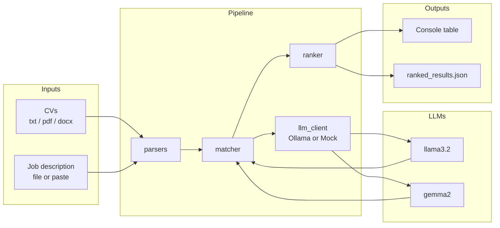

# Technical guide

Simple steps, pipeline walkthrough, and architecture.

## Prerequisites

1. Python 3.10+ recommended  
2. [Ollama](https://ollama.com) installed (skip if you only use `--mock`)  
3. Project cloned locally  

## Setup (step by step)

```bash
cd Codebase
pip install -r requirements.txt

# Start Ollama, then pull the two default models
ollama serve          # if not already running
ollama pull llama3.2
ollama pull gemma2
```

## Run ranking (CLI)

```bash
# Default: llama3.2 + gemma2
python main.py --cvs ./sample_data/cvs --jd ./sample_data/job_description.txt

# Custom models / output / skills
python main.py --cvs ./sample_data/cvs --jd ./sample_data/job_description.txt \
  --models llama3.2,gemma2 \
  --required-skills python,aws \
  --output ./ranked_results.json

# Offline / CI (no Ollama)
python main.py --cvs ./sample_data/cvs --jd ./sample_data/job_description.txt --mock
```

## Demo UI

```bash
python ui_server.py
# open http://127.0.0.1:7860
```

Upload CVs (`.txt` / `.pdf` / `.docx`) and a JD file or pasted text. The UI calls the same sorting pipeline as the CLI.

## Tests

```bash
python -m unittest discover -s . -p 'test_*.py' -v
```

## Pipeline (what happens in order)

1. **Load config** — paths, models, Ollama URL, optional skills, mock flag (`config.py`)  
2. **Parse JD** — one job description → structured text (`parsers.py`)  
3. **Discover & parse CVs** — file or folder; extract text from txt/pdf/docx  
4. **Match** — for each CV, each LLM returns a JSON score + strengths/gaps (`matcher.py` + `prompts.py` + `llm_client.py`)  
5. **Aggregate** — combine per-model scores (default equal weights)  
6. **Optional skill filter** — boost/refine with `--required-skills`  
7. **Rank & export** — sort by final score; print table; write JSON (`ranker.py`)  

## Architecture



### Module map

| Module | Role |
|--------|------|
| `main.py` | CLI entrypoint; wires config → parse → match → rank |
| `config.py` | Defaults (`llama3.2`, `gemma2`), env overrides |
| `parsers.py` | Read CV/JD files into structured text |
| `prompts.py` | System/user prompts for scoring |
| `llm_client.py` | `LLMProvider` interface; `OllamaProvider` + `MockLLMProvider` |
| `matcher.py` | Call each model per CV; aggregate scores |
| `ranker.py` | Sort, skill filter helpers, JSON/console export |
| `ui_server.py` | FastAPI demo UI calling the same pipeline |

## Swap models or backends

- **Models only:** `--models other-model-a,other-model-b` (must already be pulled in Ollama)  
- **New backend:** implement `LLMProvider.generate(...)` in `llm_client.py` and register it in `create_provider`  

No LangChain — plain Python + Ollama HTTP (`/api/chat`, JSON format).
